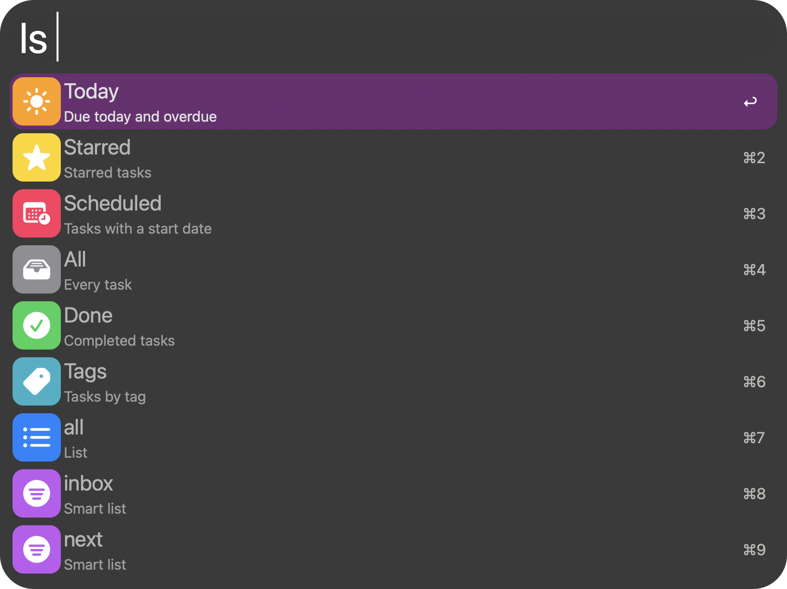
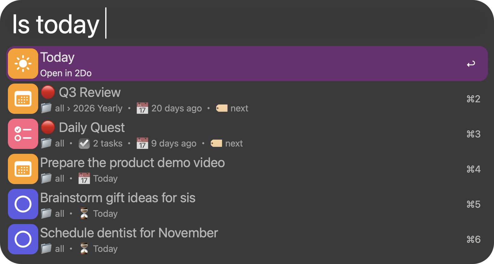
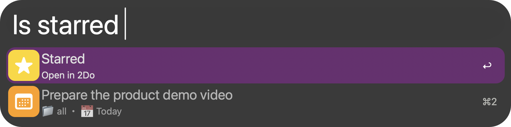
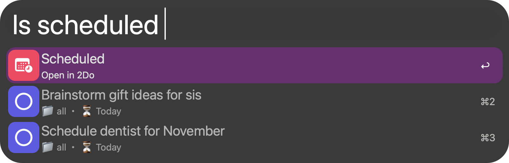

<p align="center">
  
</p>

<h1 align="center">2Do for Alfred</h1>

<p align="center">Browse, open and complete 2Do tasks and lists from Alfred.</p>

<p align="center">
  <a href="https://github.com/aleksgorbenko/alfred-workflow-2do/actions/workflows/ci.yml"></a>
  <a href="https://github.com/aleksgorbenko/alfred-workflow-2do/releases/latest"></a>
  <a href="LICENSE"></a>
  
  <a href="https://www.alfredapp.com/powerpack/"></a>
</p>

<p align="center">
  <a href="#commands">Commands</a> ·
  <a href="#install">Install</a> ·
  <a href="#development">Development</a>
</p>

Type `ls` to browse Today, Starred, Scheduled, All, Done, tags, your lists and smart lists.



Type `today` for tasks due today; overdue tasks are marked 🔴.



Alfred Workflow for [2Do](https://www.2doapp.com) tasks, projects and checklists, via the 2Do Automation Suite.

## Commands

| Keyword | Shows |
|---|---|
| `ls` | Today, Starred, Scheduled, All, Done, lists and smart lists |
| `ls today`, `ls starred`, … | That focus list; words after it search it |
| `ls tags` | No tag first, then tags by task count; pick one to list and search its tasks |
| `to <query>` | Every open task matching title, notes or tags, subtasks included |
| `today` | Tasks due today and overdue |
| `ct` | Completed tasks |

### Navigation

- Enter or Tab on a list, smart list, project or checklist opens it in Alfred.
- The path builds up in the search box (`ls today > task:…`); delete the last part to go back.
- The first row of a page is the page itself: Enter opens it in 2Do, Tab goes back.
- Words after a path filter that page.





### Keys

| Key | Action |
|---|---|
| Enter | Open the task in 2Do |
| Cmd+Enter | Complete; on a completed task, mark as not completed |
| Shift | Hold to read the note; Shift+Enter shows it in Large Type |
| Ctrl+Enter | Delete |
| Alt+Enter | Open in 2Do, also for lists and focus rows |

### Rows

- Projects (🗂️) and checklists (☑️) have their own icons and show how many tasks they hold.
- Overdue tasks start with 🔴.
- Subtasks show their list and parent: `📁 Home › Move house`.
- Each row shows start date (⏳), due date (📅) and tags; `⇧ Show note` marks tasks with a note.
- `to` and tags read subtasks and tags from an index refreshed in the background every 5 minutes and after every change.
- No tag lists top-level tasks only.

## Install

1. Download the latest `2Do.alfredworkflow` from [Releases](https://github.com/aleksgorbenko/alfred-workflow-2do/releases).
2. Double-click it - Alfred will prompt to import.
3. Requires [Alfred](https://www.alfredapp.com) with a Powerpack licence.
4. Requires 2Do for Mac with the 2Do Automation Suite, unlocked.
5. Requires Python 3.11 or newer (`brew install python`).

## Development

- Python 3.11 or newer, no runtime dependencies.
- `src/todolib/` - routing and rows; `src/bridge.js` - JXA bridge to 2Do's automation commands.
- `tools/icons.txt` - result icons, rendered by `make icons`.

```sh
make setup   # install dev tools
make ci      # everything CI runs
make check   # ruff, shellcheck, JXA compile, plist, Markdown, tests (80% coverage gate)
make icons   # render icons/*.png
make build   # package dist/2Do.alfredworkflow
make release VERSION=v1.0.0
make link-live WORKFLOW_DIR=/path/to/installed/workflow
```

## My Other Workflows

- [Netlify for Alfred](https://github.com/aleksgorbenko/alfred-workflow-netlify)
- [WaniKani for Alfred](https://github.com/aleksgorbenko/alfred-workflow-wanikani)
- [BunPro for Alfred](https://github.com/aleksgorbenko/alfred-workflow-bunpro)
- [Discogs for Alfred](https://github.com/aleksgorbenko/alfred-workflow-discogs)
- [Bandcamp for Alfred](https://github.com/aleksgorbenko/alfred-workflow-bandcamp)
- [config](https://github.com/aleksgorbenko/config) - index of all my workflows, plus macOS/iOS setup
