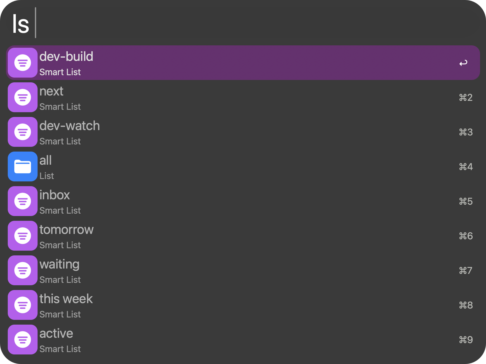

<p align="center">
  
</p>

<h1 align="center">2Do for Alfred</h1>

<p align="center">Browse, open and complete 2Do tasks and lists from Alfred.</p>

<p align="center">
  <a href="https://github.com/aleksgorbenko/alfred-workflow-2do/actions/workflows/ci.yml"></a>
  <a href="https://github.com/aleksgorbenko/alfred-workflow-2do/releases/latest"></a>
  <a href="LICENSE"></a>
  
  <a href="https://www.alfredapp.com/powerpack/"></a>
</p>

<p align="center">
  <a href="#commands">Commands</a> ·
  <a href="#install">Install</a> ·
  <a href="#development">Development</a>
</p>

Type `ls` to browse your 2Do lists and smart lists.



Alfred Workflow to browse/edit [2Do](https://www.2doapp.com) tasks/lists via its AppleScript automation suite.

Requires 2Do Mac (recent version with the `2Do Automation Suite` AppleScript dictionary).

## Commands

- **List lists & smart lists** - browse your normal lists and smart lists, each with its own icon. Selecting one opens it in 2Do.
- **Browse a list / smart list** - after selecting a list above, shows its uncompleted tasks immediately, narrows as you type. Open, complete, or delete from here.
- **Search all tasks** - live search (title, notes, tags, locations) across all uncompleted tasks as you type. Open, complete, or delete.
- **Today** - uncompleted tasks due today or overdue, shown immediately, narrows as you type. Open, complete, or delete.
- **Search completed tasks** - search completed tasks, for undoing an accidental complete. Open, uncomplete, or delete.

Each task row shows: 📁 list · 📅 due date · 🏷️ tags · 📝 notes (truncated), when present.

## Install

1. Download the latest `2Do.alfredworkflow` from [Releases](https://github.com/aleksgorbenko/alfred-workflow-2do/releases).
2. Double-click it - Alfred will prompt to import.
3. Requires [Alfred](https://www.alfredapp.com) with a Powerpack licence (Script Filters/Run Script require it).

## Development

- AppleScript only, no dependencies.
- `scripts/` - runtime scripts Alfred calls.
- `tools/icons.txt` - result icons, rendered by `make icons`.

```sh
make setup   # install dev tools
make ci      # everything CI runs
make check   # compile every AppleScript, lint plist and Markdown
make icons   # render icons/*.png
make build   # package dist/2Do.alfredworkflow
make release VERSION=v1.0.0
make link-live WORKFLOW_DIR=/path/to/installed/workflow
```

## My Other Workflows

- [Netlify for Alfred](https://github.com/aleksgorbenko/alfred-workflow-netlify)
- [WaniKani for Alfred](https://github.com/aleksgorbenko/alfred-workflow-wanikani)
- [BunPro for Alfred](https://github.com/aleksgorbenko/alfred-workflow-bunpro)
- [Discogs for Alfred](https://github.com/aleksgorbenko/alfred-workflow-discogs)
- [Bandcamp for Alfred](https://github.com/aleksgorbenko/alfred-workflow-bandcamp)
- [config](https://github.com/aleksgorbenko/config) - index of all my workflows, plus macOS/iOS setup
